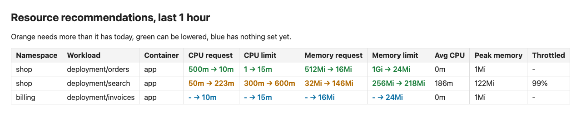

# kube-right-sizer

Most CPU and memory requests are set once, on the day a service is created, and nobody looks at them again. kube-right-sizer reads a week of real usage from Prometheus and tells you which containers ask for too much, which ask for too little, and which are stuck at their CPU limit.



## Why I wrote it

I had a few hundred pods spread over many namespaces. Some reserved 500m CPU and used 2m. Some had no requests at all, so the scheduler was guessing. A few were throttled all day long. All the numbers were already in Prometheus, but going through them one service at a time in Grafana took days, and a month later they were out of date again.

So it had to work with the Prometheus that was already there, with nothing new on the nodes, and only read from the cluster. It suggests. A person decides.

## What it calculates

| | Based on | Why |
|---|---|---|
| CPU request | mean usage + 20% | what the scheduler should keep free for normal load |
| CPU limit | p95 + 20% | going over the limit only slows the container down |
| Memory request | mean working set + 20% | normal load, same as CPU |
| Memory limit | peak + 20% | going over is an OOM kill, so p95 isn't enough |

Usage is counted over every pod the Deployment, StatefulSet or DaemonSet had during the week, so a restart on Friday doesn't throw away Monday to Thursday. If a container was throttled in more than 5% of its CPU periods, the usage you see is capped by the limit, so the limit is at least doubled and the next run measures again. Containers with no metrics are skipped, and changes under 10% aren't reported.

## Try it on kind

There's a demo that builds the image, starts a kind cluster with a small Prometheus and three apps that are sized badly on purpose. It needs Docker, kind, kubectl and Helm on your machine.

```bash
git clone https://github.com/umairedu/kube-right-sizer
cd kube-right-sizer
make demo
```

`shop/orders` reserves 500m and 512Mi and just sleeps. `shop/search` spins a CPU loop and holds about 120Mi on a 50m / 32Mi request. `billing/invoices` sets nothing at all. All three containers are called `app`. After about five minutes the CronJob has run once and prints:

```
analyzing the last 1 hour from http://prometheus.monitoring.svc:9090
3 containers need new requests or limits
Namespace    Workload             Container    CPU request    CPU limit     Memory request    Memory limit    Avg CPU    Peak memory    Throttled
-----------  -------------------  -----------  -------------  ------------  ----------------  --------------  ---------  -------------  -----------
shop         deployment/orders    app          500m -> 10m    1 -> 15m      512Mi -> 16Mi     1Gi -> 24Mi     0m         1Mi            -
shop         deployment/search    app          50m -> 205m    300m -> 600m  32Mi -> 146Mi     256Mi -> 218Mi  171m       122Mi          99%
billing      deployment/invoices  app          - -> 10m       - -> 15m      - -> 16Mi         - -> 24Mi       0m         1Mi            -

apiVersion: apps/v1
kind: Deployment
metadata:
  name: orders
  namespace: shop
spec:
  template:
    spec:
      containers:
      - name: app
        resources:
          requests:
            cpu: 10m
            memory: 16Mi
          limits:
            cpu: 15m
            memory: 24Mi
---
...
```

`search` was throttled 99% of the time, which is why its CPU limit goes up to 600m even though it never used more than 300m. `make demo-down` deletes the cluster when you're done.

## Installing

```bash
# point it at your Prometheus
helm upgrade --install right-sizer oci://ghcr.io/umairedu/charts/kube-right-sizer --version 1.1.0 \
  -n right-sizer --create-namespace \
  --set env.PROMETHEUS_URL=http://prometheus-server.monitoring.svc:9090

# optional: Slack. The bot needs chat:write and files:write, and has to be in the channel.
kubectl -n right-sizer create secret generic slack-bot --from-literal=SLACK_TOKEN=xoxb-...
helm upgrade right-sizer oci://ghcr.io/umairedu/charts/kube-right-sizer --version 1.1.0 \
  -n right-sizer --reuse-values \
  --set slack.channel=C0123456789 --set slack.existingSecret=slack-bot

# it runs on Mondays at 06:00, this runs it right now
kubectl -n right-sizer create job first-run --from=cronjob/right-sizer
kubectl -n right-sizer logs -f job/first-run
```

The service account can list namespaces, pods and replicasets. That's all it gets. If you'd rather change the chart itself, it's in `chart/` and `./chart` works in place of the oci:// address.

The YAML in the output is a set of patches, one per workload. The right home for the new numbers is your manifests or Helm values, otherwise the next deploy puts the old ones back. If you just want to try one:

```bash
kubectl apply --server-side --field-manager=right-sizer --force-conflicts -f recommendations.yaml
```

Namespaces, history length, buffer, schedule and output format are all settings. They're listed in [docs/settings.md](docs/settings.md), together with a bigger example and how to run it from your laptop.
